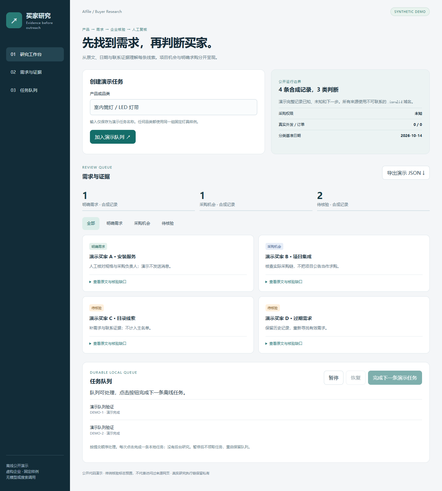

# Buyer Research Agent

An offline reference workflow for classifying buyer demand, keeping verification gaps visible, and reviewing records in a local queue.

[中文说明](README.zh.md) · [Portfolio](https://github.com/Daniel-24-life/AIfile)



## What it demonstrates

- Distinguish explicit demand, purchase opportunity, and unverified lead.
- Open the original synthetic text and record supporting facts and gaps.
- Review queued records in a local SQLite-backed workbench.

**Stack** · Python, SQLite, HTML, CSS, JavaScript

## Repository layout

| Path | Contents |
| --- | --- |
| [`core.py`](core.py) | Evidence rules and record operations |
| [`server.py`](server.py) | Local workbench server |
| [`dist/`](dist/) | Static interface |
| [`sample.fake.json`](sample.fake.json) | Synthetic input |
| [`tests/`](tests/) | Core, server, and interface checks |

## Run locally

```sh
python -B server.py
python -B -m unittest discover -s tests -v
```

Open the local address printed by the server.

## Scope and limits

The included records are synthetic and the workflow runs locally. It does not discover live leads, contact prospects, or estimate the value of a real opportunity.

[Architecture](docs/architecture.md) · [Verification](docs/VERIFICATION.md)
