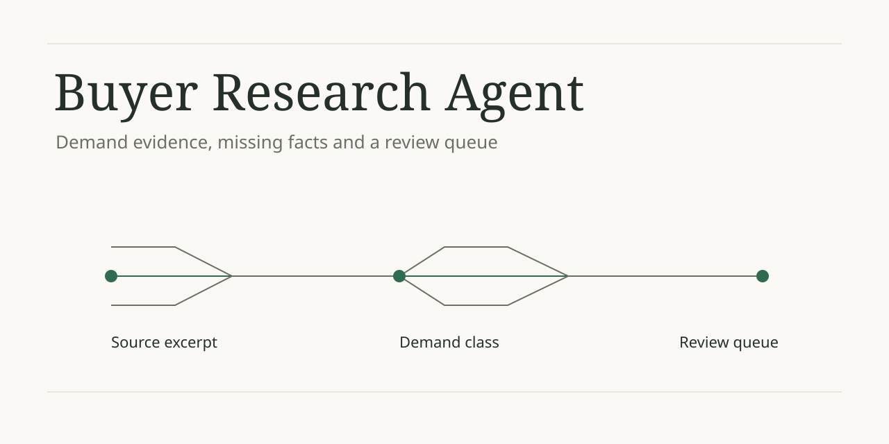
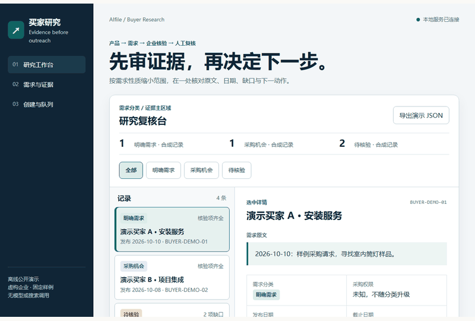
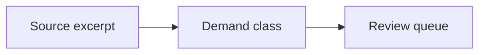

<picture>
  <source media="(prefers-color-scheme: dark)" srcset="docs/cover-dark.svg" />
  <source media="(prefers-color-scheme: light)" srcset="docs/cover-light.svg" />
  
</picture>

# Buyer Research Agent

Separate explicit buyer demand from tentative leads and keep verification gaps visible in a review queue.

[▶ Demo](#demo) · [中文](README.zh.md) · [](https://github.com/Daniel-24-life/buyer-research-agent/actions/workflows/ci.yml) · [MIT](LICENSE) · Python 3.11+

## Demo



## Problem

A short buyer excerpt can indicate a direct request, a broader opportunity, or only a clue. Research needs the source text and missing checks next to the classification.

## What I built

- Classify incoming records by demand strength.
- Open source excerpts and mark what still needs verification.
- Record review decisions in a SQLite-backed workbench.

## How it works



## Run in 60 seconds

```sh
python -B server.py
```

Once the local server starts, open [http://127.0.0.1:4182/](http://127.0.0.1:4182/).

## Tests

**19 tests passed.** [Verified GitHub Actions run](https://github.com/Daniel-24-life/buyer-research-agent/actions/runs/45105682256).

```sh
python -B -m unittest discover -s tests -v
```

## Repository layout

| Path | Contents |
| --- | --- |
| [`core.py`](core.py) | Evidence classification and actions |
| [`server.py`](server.py) | Local server |
| [`dist/`](dist/) | Research interface |
| [`sample.fake.json`](sample.fake.json) | Scenario fixtures |

Reference material · [architecture.md](docs/architecture.md) · [VERIFICATION.md](docs/VERIFICATION.md)

<sub>Demo data is synthetic; modeled on real-world workflows. The public workbench reviews the bundled records. It performs no live buyer discovery or outreach.</sub>
