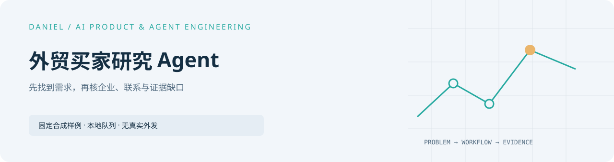

<picture>
  <source media="(prefers-color-scheme: dark)" srcset="docs/assets/cover-dark.svg" />
  
</picture>

# 外贸买家研究 Agent

[完整作品目录](https://github.com/Daniel-24-life/AIfile)

一个可独立运行的离线公开重建：用固定合成证据演示需求分类，并用 SQLite 保存本地任务队列。它面向想了解“先找需求、再核企业与联系证据”的老板、销售和工程团队。


## 快速开始

需要 Python 3.11 或更高版本，不需要安装依赖、配置凭据或接入模型。

```powershell
python server.py
```

浏览器打开 <http://127.0.0.1:4182>。如需改端口，可运行 `python server.py --port 4184`。服务只监听本机回环地址，SQLite 状态写入已忽略的 `.runtime/`。

## 可以体验什么

1. 查看四条虚构灯具记录，筛选“明确需求”“采购机会”和“待核验”。
2. 展开原文、发布日期、截止日期、证据缺口和下一步动作。
3. 创建两个演示任务，暂停、恢复，然后每次手动完成一条；队列按 FIFO 顺序处理。
4. 取消尚未处理的任务，重启服务后确认状态仍在。
5. 导出合成 JSON。

产品输入只改变任务标签，不会触发抓取，也不会生成该品类的新研究结果。样例中的核验标志都是固定夹具；所有来源均使用不可联系的 `.invalid` 域名。

## 公开边界

本仓库包含分类器、SQLite 演示队列、本地 JSON API、响应式页面、四条合成记录、13 个 `unittest` 测试和公开截图。

它不执行真实买家研究、网页抓取、模型调用、联系人发现、外联、邮件发送、订单验证或后台任务。队列没有工作进程：只有点击“完成下一条演示任务”才会在本地完成一步。真实客户、联系方式、研究报告、提示词、执行历史和私有执行链均未包含。

采购权限始终保持“未知”。目录匹配不等于采购意图，项目公告只归为采购机会，缺失或过期证据进入待核验。

## 代码与文档

| 路径 | 内容 |
| --- | --- |
| [core.py](core.py) | 证据分类、固定日期判断、SQLite 队列和幂等请求。 |
| [server.py](server.py) | 仅回环地址可用的 API 与静态文件白名单。 |
| [sample.fake.json](sample.fake.json) | 四条虚构记录；标志固定，不来自抓取。 |
| [dist/](dist/) | 无构建步骤的浏览器界面。 |
| [tests/](tests/) | 分类、队列、重启与 HTTP 边界测试。 |
| [docs/architecture.md](docs/architecture.md) | 架构、契约和私有集成边界。 |
| [docs/reference-guide.md](docs/reference-guide.md) | 证据字段、本地 API 与扩展顺序。 |
| [docs/SOURCE_READING_GUIDE.md](docs/SOURCE_READING_GUIDE.md) | 推荐源码阅读路径。 |
| [docs/VERIFICATION.md](docs/VERIFICATION.md) | 可复现的验证步骤。 |
| [MIGRATION.md](MIGRATION.md) | 公开来源、提交和独立路径迁移记录。 |

运行验证：

```powershell
python -B -m unittest discover -s tests -v
node --check dist/app.js
```

[英文说明](README.en.md)。上游公开项目：[Daniel-24-life/AIfile](https://github.com/Daniel-24-life/AIfile)。
