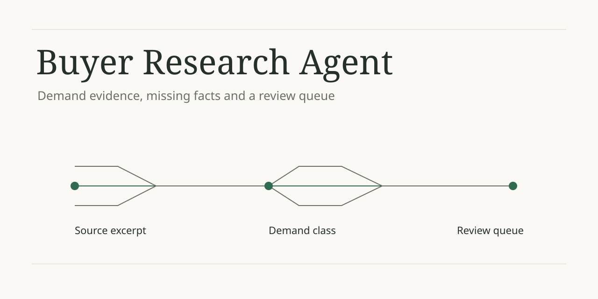
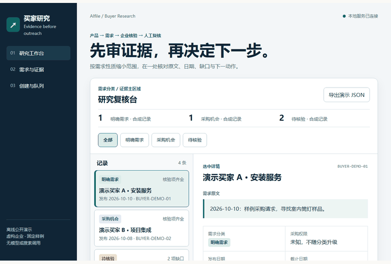

<picture>
  <source media="(prefers-color-scheme: dark)" srcset="docs/cover-dark.svg" />
  <source media="(prefers-color-scheme: light)" srcset="docs/cover-light.svg" />
  
</picture>

# 买家研究工作台

区分明确需求、采购机会与待核验线索，在队列中保留原文和验证缺口。

[查看演示](#demo) · [English](README.md) · [](https://github.com/Daniel-24-life/buyer-research-agent/actions/workflows/ci.yml) · [MIT](LICENSE) · Python 3.11+

## Demo



## 要解决的问题

研究到的买家可能只有零散来源。需要把已知需求、证据缺口和待核任务放在同一审阅上下文。

## 实现

- 按需求证据强度整理线索。
- 查看原文并记录缺失线索。
- 在 SQLite 工作台保存复核决定。

## 工作流程


## 快速运行

```sh
python -B server.py
```

启动后打开 [http://127.0.0.1:4182/](http://127.0.0.1:4182/)。

## 测试

实测 **19 项通过**。[通过的 GitHub Actions 运行](https://github.com/Daniel-24-life/buyer-research-agent/actions/runs/45105682256)。

```sh
python -B -m unittest discover -s tests -v
```

## 仓库目录

| 路径 | 内容 |
| --- | --- |
| [`core.py`](core.py) | Evidence classification and actions |
| [`server.py`](server.py) | Local server |
| [`dist/`](dist/) | Research interface |
| [`sample.fake.json`](sample.fake.json) | Scenario fixtures |

延伸阅读 · [architecture.md](docs/architecture.md) · [VERIFICATION.md](docs/VERIFICATION.md)

<sub>示例来源、买家和线索均为合成数据。审核队列保存在本地。</sub>
